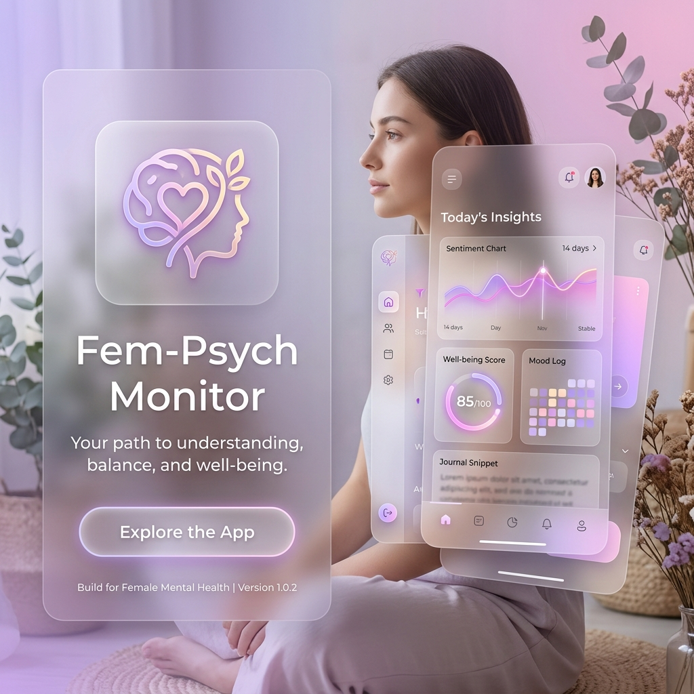

<div align="center">



# 🧠 Fem-Psych Monitor
### *Empowering Women through Emotional Intelligence and AI*

[](https://flutter.dev)
[](https://www.tensorflow.org/lite)
[](https://sqlite.org)

</div>

---

## 🌟 Tentang Proyek
**Fem-Psych Monitor** (Fem-PhysicsMonitor) adalah aplikasi pemantauan kesehatan mental yang dirancang khusus untuk perempuan. Menggabungkan psikometri (MBTI) dengan teknologi **Voice Emotion Intelligence** berbasis AI, aplikasi ini membantu pengguna memahami dinamika emosional mereka secara real-time dan memberikan saran yang dipersonalisasi.

Aplikasi ini bertujuan untuk menjadi asisten digital yang menyediakan ruang aman bagi perempuan untuk melacak kondisi psikologis mereka, mengidentifikasi pola stres, dan mendapatkan dukungan mandiri melalui rekomendasi berbasis sains.

## 🚀 Fitur Unggulan

### 1. 📋 Onboarding & Profil Psikologis
Sistem penilaian awal yang komprehensif untuk membangun profil dasar pengguna:
- **MBTI Assessment**: Tes kepribadian terintegrasi untuk menentukan tipe kepribadian (16 tipe).
- **Mental Health Check**: Kuesioner kesehatan mental awal untuk menentukan base-line kondisi psikis.
- **Dynamic Categorization**: Pengelompokan kondisi mental dalam kategori: *Baik*, *Cukup*, atau *Perlu Perhatian*.

### 2. 🎙️ Voice Emotion Intelligence (AI)
Fitur inti yang mendeteksi emosi melalui suara menggunakan model **TensorFlow Lite**:
- **Real-time Recording**: Merekam suara dan melakukan inferensi instan.
- **Multi-Emotion Detection**: Mendeteksi emosi seperti *Happy*, *Sad*, *Angry*, *Fear*, *Disgust*, dan *Neutral*.
- **Emotion Snapshots**: Mengambil data emosi setiap 3 detik untuk analisis durasi yang lebih akurat.

### 3. 📊 Dashboard & Visualisasi Data
Memantau perkembangan kesehatan mental melalui grafik yang interaktif:
- **Emotional Trends**: Grafik garis dan batang menggunakan `fl_chart`.
- **History Tracking**: Log lengkap riwayat rekaman dan hasil deteksi.
- **Consistency Score**: Melihat seberapa stabil kondisi emosi dalam rentang waktu mingguan/bulanan.

### 4. 💡 Smart Recommendations
Sistem saran cerdas yang mengambil data dari `saran.json`:
- **Personalized Advice**: Saran yang disesuaikan dengan tipe MBTI (Contoh: saran untuk *INFJ* berbeda dengan *ESTP*).
- **Emotion-Based Strategy**: Memberikan langkah praktis berdasarkan emosi dominan yang terdeteksi.

## 🛠️ Stack Teknologi
- **Framework**: [Flutter](https://flutter.dev)
- **State Management**: [Provider](https://pub.dev/packages/provider)
- **Autentikasi**: Firebase Auth (Google Sign-In) — *tetap dipakai*
- **Backend Database & Storage**: PHP + MySQL (cPanel) via `http` (REST API)
- **AI/ML Engine**: [TensorFlow Lite Flutter](https://pub.dev/packages/tflite_flutter) + Whisper (transkripsi)
- **Data Persistence**: [Shared Preferences](https://pub.dev/packages/shared_preferences) + server API
- **Charts**: [fl_chart](https://pub.dev/packages/fl_chart)
- **Audio Management**: [record](https://pub.dev/packages/record)

## 📦 Struktur Project
```text
lib/
├── l10n/              # File lokalisasi (i18n)
├── models/            # Model data (AppUser, EmotionRecord)
├── screens/           # Tampilan antarmuka (Auth, Home, History, dll)
├── services/          # Logika database, storage, dan ML
├── theme/             # Konfigurasi gaya visual (Light/Dark mode)
└── widgets/           # Komponen UI yang reusable
```

## ⚙️ Cara Instalasi

### Prasyarat
- Flutter SDK v3.11 atau lebih baru.
- Android Studio / VS Code dengan plugin Flutter.
- Server cPanel dengan PHP 8+ & MySQL (untuk backend).

### Langkah-langkah
1. **Deploy Backend (cPanel)**:
   Salin isi folder `cpanel_api/api/` ke `public_html/api/`, buat database MySQL, import `cpanel_api/schema.sql`, lalu isi kredensial di `api/config.php` (lihat [cpanel_api/README.md](cpanel_api/README.md)).
2. **Konfigurasi `.env`**:
   Salin `.env.example` menjadi `.env` dan isi `API_BASE_URL` (alamat `https://domain.com/api`) serta `API_KEY` — **wajib sama** dengan `API_KEY` di `config.php`.
3. **Clone Repositori**:
   ```bash
   git clone https://github.com/username/fem_physicsmonitor.git
   ```
4. **Instal Dependensi**:
   ```bash
   flutter pub get
   ```
5. **Persiapkan Model AI**:
   Pastikan file `assets/model_female.tflite` ada di folder assets.
6. **Jalankan Aplikasi**:
   ```bash
   flutter run
   ```

> **Catatan migrasi**: Firestore & Firebase Storage sudah diganti dengan backend PHP+MySQL.
> Firebase Auth (login Google) tetap dipakai; UID Firebase menjadi kunci identitas user di database.

## 📂 Data & Aset Utama
- `assets/model_female.tflite`: Model machine learning untuk klasifikasi emosi suara.
- `assets/MBTI.json`: Bank soal untuk penilaian tipe MBTI.
- `assets/psych.json`: Daftar pertanyaan kesehatan mental.
- `assets/saran.json`: Database saran psikologis berbasis MBTI & Emosi.

---
<div align="center">
  Dibuat dengan ❤️ untuk Kesehatan Mental Perempuan
</div>
