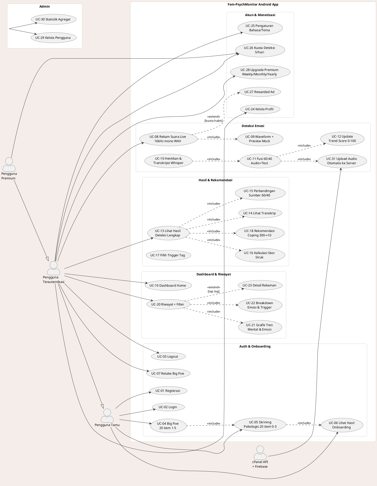
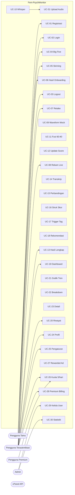

# Use Case Diagram — Fem-PsychMonitor (Sesuai IMPLEMENTASI Aktual v2.1.5+8)

> Dokumen ini merefleksikan **kode yang ada** di `lib/` (audit 23 Agu 2026), **bukan** `blueprint.md`. Semua UC dapat dilacak ke `file:line`.

---

## 1. Aktor

| Aktor | Deskripsi | Autentikasi | File terkait |
|---|---|---|---|
| **Pengguna Tamu (Guest)** | Belum login. Hanya bisa akses Welcome/Onboarding & Auth | Tidak | `lib/screens/onboarding/welcome_section.dart:11`, `lib/screens/auth_screen.dart` |
| **Pengguna Terautentikasi** | User Firebase Auth biasa. Akses penuh fitur deteksi, riwayat, profil | Firebase Auth `lib/providers/auth_provider.dart` | `lib/main.dart:192` `AppRouter` |
| **Pengguna Premium** | Subset dari Terautentikasi, `isPremium==true` (BillingService) | Play Billing | `lib/providers/premium_provider.dart`, `lib/screens/premium_screen.dart:294` |
| **Admin** | Akun khusus `ConfigService.adminEmail` auto-create `lib/main.dart:80` | `isAdmin==true` `lib/services/database_service.dart:207` | `lib/screens/admin/admin_dashboard_screen.dart` |
| **Sistem Eksternal (sekunder)** | Firebase Auth, cPanel API (`upload.php`, `recording.php`), WhisperKit, TFLite — digambar sebagai aktor sekunder jika pakai notasi lengkap | — | `lib/services/api_service.dart:127`, `lib/services/whisper_init_service.dart` |

> Generalisasi: `Pengguna Premium ──▷ Pengguna Terautentikasi ──▷ Pengguna Tamu` (inheritan).

---

## 2. Batas Sistem (System Boundary)

**`Fem-PsychMonitor Android App`** — `lib/main.dart:125` `FemPhysicsMonitorApp`. Semua UC di dalam boundary kecuali aktor eksternal di luar.

---

## 3. Daftar Use Case Lengkap (Implementasi)

| ID | Use Case | Aktor Utama | Prekondisi | Deskripsi Singkat | File |
|---|---|---|---|---|---|
| UC-01 | **Registrasi Akun** | Tamu | App terinstal | Email+password atau Google Sign-In, buat `AppUser` kosong | `lib/screens/auth_screen.dart` |
| UC-02 | **Login** | Tamu | Punya akun | Firebase `signInWithEmailAndPassword` / `GoogleSignIn` | `lib/providers/auth_provider.dart` |
| UC-03 | **Logout** | Terautentikasi | Login | `PopupMenu` Home → `AuthProvider.logout()` → `AppRouter` | `lib/screens/home_screen.dart:370` |
| UC-04 | **Onboarding — Kuesioner Big Five (20 item, 1-5)** | Terautentikasi/Tamu* | First launch `StorageService.isFirstLaunch()` | 1 soal/layar `PageView` NeverScrollable, `ResonanceProgressBar`, 5 opsi Likert, auto-next 300ms | `lib/screens/onboarding/bigfive_section.dart:306`, `onboarding_state.dart:76` |
| UC-05 | **Onboarding — Skrining Psikologis Perempuan (20 item, 0-3)** | Terautentikasi/Tamu | Selesai UC-04 | 4 opsi skor `0-3`, warna skala muted `psy_section.dart:23` | `lib/screens/onboarding/psy_section.dart:295` |
| UC-06 | **Lihat Hasil Onboarding** | Terautentikasi | Selesai UC-04+05 | Skor `displayScore100=(60-psy)/60*100` `result_section.dart:147`, kategori 76/51/26, `BigFiveCard` OCEAN + `ScoreRing` | `lib/screens/onboarding/result_section.dart:23` |
| UC-07 | **Isi Ulang Big Five (Retake)** | Terautentikasi | Punya `bigFiveScores` | Layar terpisah retake | `lib/screens/big_five_retake_screen.dart` |
| UC-08 | **Rekam Suara Live** | Terautentikasi | Permission mic, model loaded `AudioRecorderWithDetection.loadModel()` | `Record 16kHz mono WAV` `emotion_detection_screen.dart:190`, waveform 30 bar `List _waveHeights:58`, `pulseCtrl 900ms` | `lib/screens/emotion_detection_screen.dart:161`, `lib/screens/live_detection_screen.dart:39` |
| UC-09 | **Lihat Waveform Real-time + Preview Emosi Mock** | Terautentikasi | UC-08 running | `_emotionUpdateTimer 3s` → `_generateMockScores():262` random shuffle (bukan TFLite di path ini) | `lib/screens/emotion_detection_screen.dart:204` |
| UC-10 | **Hentikan Rekaman & Proses** | Terautentikasi | UC-08 | `stop()` → `Whisper base → fallback tiny` `lib/screens/emotion_detection_screen.dart:310`, `TextEmotionService.analyze()` leksikon 381+424 kata | `lib/screens/emotion_detection_screen.dart:275` |
| UC-11 | **Fusi Multimodal 60:40** | Sistem | UC-10 transcript ada | `GeminiService.combineResults(audio*0.6+text*0.4)` `services/gemini_service.dart:22` → `dominant` | `lib/screens/emotion_detection_screen.dart:381` |
| UC-12 | **Update Emotion Trend Score** | Sistem | UC-11 `dominant!=neutral` | `computeMentalHealthAdjustment:201` `sum emotionValue*prob` → `DatabaseService.updateUser(newScore.clamp 0-100)` | `lib/screens/emotion_detection_screen.dart:440` |
| UC-13 | **Lihat Hasil Deteksi Lengkap** | Terautentikasi | UC-11 selesai | `ResultScreen` hero `confidence`+`duration`, strip komposisi, radar `fl_chart`, score bars LIVE | `lib/screens/result_screen.dart:76` |
| UC-14 | **Lihat Transkrip + Highlight Leksikon** | Terautentikasi | UC-10 punya `transcriptText` | `_quoteBlock` Lora italic, `Wrap` chips `emotion.json` >0.05 | `lib/screens/result_screen.dart:732` |
| UC-15 | **Lihat Perbandingan Sumber (Audio 60% vs Teks 40%)** | Terautentikasi | UC-11 | Bar fusi 6:4 + 2 row ringkasan dominant per sumber | `lib/screens/result_screen.dart:974` |
| UC-16 | **Lihat Kalkulasi Skor (Struk)** | Terautentikasi | UC-11 | `scoreTrend` receipt `baseValue` `confidence` → `emotionScore ±1 des` `DashedLine` | `lib/screens/result_screen.dart:1234` |
| UC-17 | **Pilih Trigger Tag (Wajib)** | Terautentikasi | Di `ResultScreen` | `TriggerTag.values 7` `Wrap` `AnimatedContainer` → `triggerTag` disimpan via `insertRecording` | `lib/screens/result_screen.dart:1397`, `models/emotion_model.dart:7` |
| UC-18 | **Lihat Rekomendasi Coping Deterministik** | Terautentikasi | UC-11 + `bigFiveScores` | `SuggestionService.getStructuredSuggestions` → matriks 300 → shuffle `take(2)` per dimensi → `SuggestionCard` | `lib/services/suggestion_service.dart:146`, `widgets/suggestion_card.dart` |
| UC-19 | **Lihat Dashboard Home** | Terautentikasi | Login | Greeting time-based `home_screen.dart:96`, `PsychCard` gradient score 0-100, `Bento 2x2` stats, CTA mic pulse, `OverallSuggestion` | `lib/screens/home_screen.dart:132` |
| UC-20 | **Lihat Riwayat & Filter** | Terautentikasi | Punya recordings | `HistoryScreen` `TabController 2`, `TimeFilter` All/Today/7d/30d/Custom `DateRangePicker`, `Filter Chips` emosi | `lib/screens/history_screen.dart:22` |
| UC-21 | **Lihat Grafik Tren** | Terautentikasi | UC-20 data ada | `MentalScoreChart 0-100` gradient `6B4C56→A8AF9E` + `WeeklyLineChart -10→11` `fl_chart` | `lib/screens/history_screen.dart:693`, `866` |
| UC-22 | **Lihat Breakdown Emosi & Trigger Chart** | Terautentikasi | UC-20 | List frekuensi + `see_all` pill | `lib/screens/history_screen.dart:330` |
| UC-23 | **Lihat Detail Rekaman** | Terautentikasi | Tap log item | Full `RecordDetailScreen` `audio_url` player? | `lib/screens/record_detail_screen.dart` |
| UC-24 | **Kelola Profil & Foto** | Terautentikasi | Login | `profile_screen.dart` `SharedPreferences profile_photo_{email}` FileImage | `lib/screens/profile_screen.dart:77` |
| UC-25 | **Pengaturan (Bahasa, Tema, Notifikasi, Privacy)** | Terautentikasi | — | `settings_screen.dart` `LocaleProvider` ID/EN, `ThemeProvider` light/dark, `NotificationService` | `lib/screens/settings_screen.dart` |
| UC-26 | **Kelola Kuota Deteksi** | Terautentikasi/Premium | — | `StorageService.getRemainingDetections(uid)` `5/hari` → `premium.isPremium ? ∞`, `home_screen:1132` | `lib/services/storage_service.dart` |
| UC-27 | **Tonton Rewarded Ad untuk Tambah Kuota** | Terautentikasi | `remaining<=0` & `!isPremium` | `showRewardedAdDialog` → `AdService.showRewardedAd()` → `showRewardSuccessDialog` | `lib/screens/emotion_detection_screen.dart:136` |
| UC-28 | **Upgrade Premium (Billing)** | Terautentikasi | — | `premium_screen.dart:41` 3 plan `weekly/monthly/yearly` `isPopular yearly`, `BillingService.purchase/restore`, `countdown expiry` | `lib/screens/premium_screen.dart:258` |
| UC-29 | **Admin — Kelola Pengguna** | Admin | `isAdmin` | `admin_dashboard_screen.dart` list users, `user_detail_screen.dart` detail + delete | `lib/screens/admin/admin_dashboard_screen.dart:147` |
| UC-30 | **Admin — Lihat Statistik Agregat** | Admin | — | `admin_charts.dart` `fl_chart` agregat | `lib/screens/admin/widgets/admin_charts.dart` |
| UC-31 | **Unggah Audio ke Server (Otomatis pasca-deteksi)** | Sistem | UC-10 selesai | `ApiService.uploadAudio(_wavPath)` `POST /upload.php` multipart → `audio_url` disimpan `DatabaseService.updateRecordingAudioUrl` → **berbeda dari blueprint** (metadata-only) | `lib/screens/emotion_detection_screen.dart:419`, `services/api_service.dart:127` |

> **Tidak ada di implementasi (ada di blueprint tapi belum ada kode):** `Unggah Berkas Audio manual (file_picker WAV/MP3)` — blueprint §5 Use Case “Mengunggah Berkas Audio” tidak ditemukan (`grep file_picker` hanya foto profil).

---

## 4. Relasi Include / Extend / Generalization

| Dari | Relasi | Ke | Makna |
|---|---|---|---|
| UC-08 Rekam | `<<include>>` | UC-09 Waveform/Mock | Rekam selalu tampilkan preview |
| UC-10 Hentikan | `<<include>>` | Whisper Transkripsi Base→Tiny fallback | Wajib sebelum fusi |
| UC-10 | `<<include>>` | UC-11 Fusi 60:40 |  |
| UC-11 | `<<include>>` | UC-12 Update Trend Score | Otomatis jika `dominant != neutral` |
| UC-13 Lihat Hasil | `<<include>>` | UC-14 Transkrip |  |
| UC-13 | `<<include>>` | UC-15 Perbandingan Sumber |  |
| UC-13 | `<<include>>` | UC-16 Kalkulasi Skor |  |
| UC-13 | `<<include>>` | UC-18 Rekomendasi | Hasil selalu tampilkan 10 coping |
| UC-08 | `<<extend>>` | UC-27 Rewarded Ad | Hanya jika `remaining==0 && !premium` `emotion_detection_screen.dart:168` |
| UC-04 | `<<include>>` | UC-05 | Onboarding urut BigFive → Psikologi → Hasil |
| UC-06 | `<<include>>` | UC-28 Upgrade (opsional) | `home_screen.dart:518` `if !isPremium Navigator PremiumScreen` |
| UC-20 Riwayat | `<<extend>>` | Filter Waktu & Filter Emosi | `HistoryScreen` `TimeFilter` `selectedFilter` |
| UC-20 | `<<include>>` | UC-21 Grafik Tren |  |
| Pengguna Premium | `--▷` | Pengguna Terautentikasi | Generalization |
| UC-31 Upload | `<<include>>` | UC-10 (otomatis) | Tidak ada interaksi user |

---

## 5. Diagram Use Case — PlantUML (siap paste ke plantuml.com)

---

## 6. Diagram Use Case — Mermaid (untuk GitHub / docs)

---

## 7. Catatan Kritis vs Blueprint

- **Unggah Berkas Audio manual tidak ada** di implementasi — hanya rekam live. Jika butuh, tambah `file_picker` + transcode ke `WAV 16kHz mono` lalu reuse `UC-10`.
- **Deteksi saat ini mock** pada `UC-09` (`_generateMockScores` random). Untuk klaim “TFLite 89.59%” harus ganti dengan `AudioRecorderWithDetection.extractAudioFeatures()` + `Interpreter.run()` di `UC-11`.
- **Upload audio otomatis** (`UC-31`) bertentangan dengan blueprint “metadata-only”. Pertahankan sebagai UC terpisah agar terlihat eksplisit.
- **4 strata skor** di kode `76/51/26` berbeda dengan `psych.json` `80/60/40` — diagram tetap pakai 1 UC (`UC-12`) tapi logic bercabang.
- **Premium** adalah generalisasi, bukan aktor terpisah — di diagram digambar `Premium --|> User`.

---

## 8. Cara Render

- **PlantUML**: paste kode §5 ke https://plantuml.com/plantuml → Export PNG/SVG
- **Mermaid**: paste kode §6 ke https://mermaid.live atau di GitHub README langsung ter-render
- **Draw.io**: File → Arrange → Insert → Advanced → PlantUML

